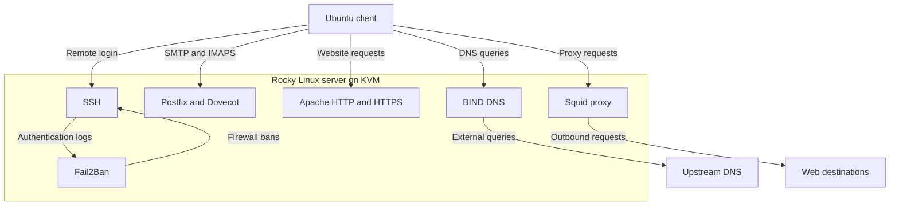
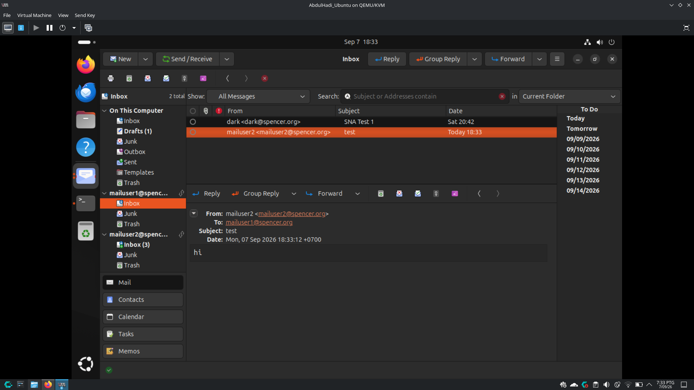
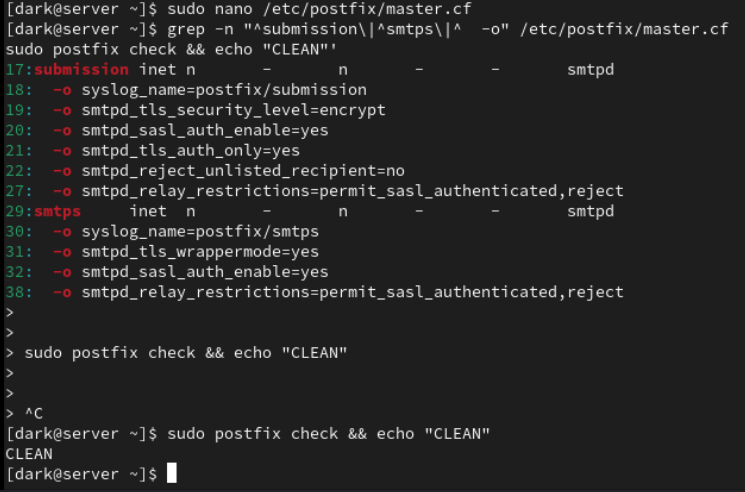
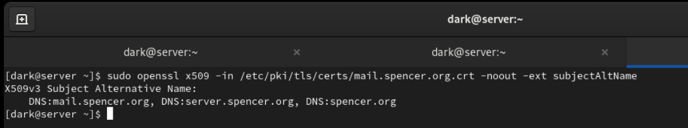
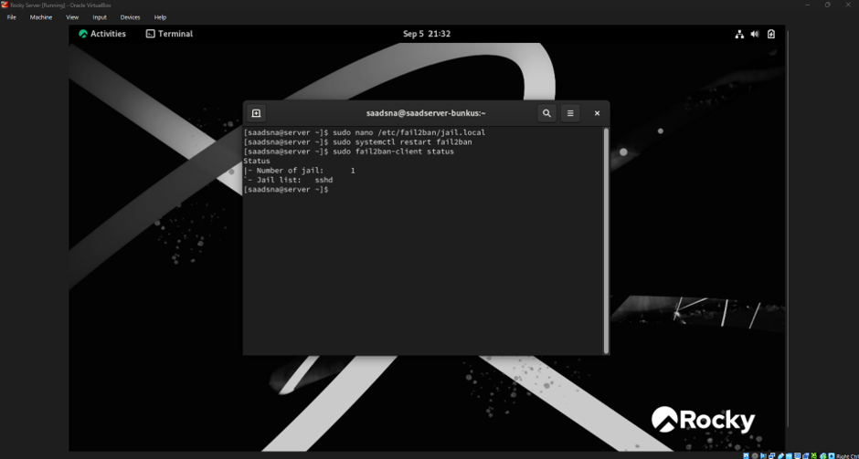
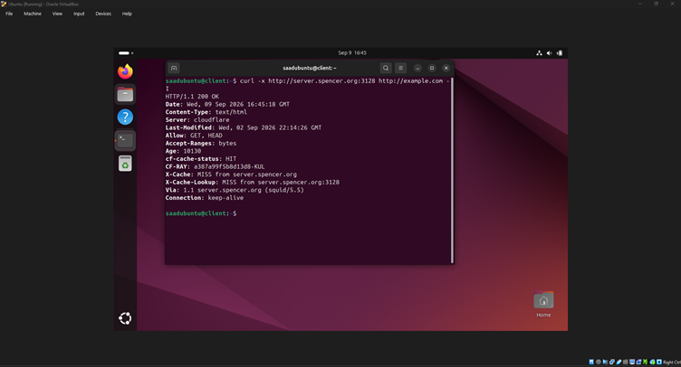

# Linux Server Infrastructure LAB


A team-built Linux infrastructure lab combining DNS, email, web hosting, SSH protection, and an HTTP proxy on one Rocky Linux server. An Ubuntu client was used to verify the services individually and together in a KVM environment.

The project demonstrates service integration, Linux administration, certificate management, and troubleshooting across the network and application layers. This README presents the completed work and a guided implementation and verification workflow for readers building a similar lab.

**Project status:** The integrated lab was completed and tested, including a server restart. This repository currently contains documentation and selected screenshots. Configuration exports and automation scripts are planned; the workflow below is a reference, not an unattended installer.

[Services](#services) · [Architecture](#architecture) · [Build and verify](#build-and-verify) · [Results](#results) · [Screenshots](#screenshots) · [Lessons](#lessons-and-troubleshooting) · [Contributors](#contributors)

## Services

| Component | Implementation | Demonstrated capability |
| --- | --- | --- |
| DNS | BIND | Forward and reverse resolution, MX records, external forwarding |
| Email | Postfix and Dovecot | Authenticated submission, IMAP access, Maildir delivery, TLS |
| Web | Apache HTTP Server | Separate main and blog sites using name-based virtual hosts and HTTPS |
| SSH protection | Fail2Ban | Failed-login detection, temporary bans, and access recovery |
| Forward proxy | Squid | Client web requests through a proxy with access logging |
| Supporting controls | firewalld, SELinux, OpenSSL, systemd | Network access rules, policy checks, certificates, and service management |

## Architecture

The final integrated environment uses two KVM virtual machines connected to a shared lab network. The Rocky Linux server also needs outbound connectivity for external DNS resolution and proxy requests. Fixed IP addresses are intentionally omitted; choose addresses appropriate to your own virtual network.



`spencer.org` is the lab naming context. These names must resolve through the lab DNS server; they are not advertised here as public services.

| Name | Role |
| --- | --- |
| `server.spencer.org` | Rocky Linux server and main website |
| `client.spencer.org` | Ubuntu client |
| `mail.spencer.org` | SMTP and IMAP endpoint |
| `blog.spencer.org` | Second Apache website |

<details>
<summary><strong>Ports and service boundaries</strong></summary>

| Port | Protocol | Use |
| --- | --- | --- |
| 22 | TCP | SSH administration, monitored by Fail2Ban |
| 53 | UDP and TCP | DNS |
| 25 | TCP | SMTP transport where required by the lab |
| 80 / 443 | TCP | HTTP / HTTPS |
| 587 | TCP | Authenticated SMTP submission using STARTTLS |
| 465 | TCP | Authenticated SMTP submission using implicit TLS |
| 993 | TCP | IMAP using implicit TLS |
| 3128 | TCP | Squid client proxy connections |

Expose only the services needed on the lab-facing interface. DNS recursion and proxy access should be limited to the lab network. The mail demonstration covers local users; public email delivery and domain reputation were outside its scope.

</details>

## Build and verify

Prepare one Rocky Linux VM, one Ubuntu VM, administrator access to both, a shared KVM network, and outbound package access. Assign stable addresses and keep VM console access available while changing networking or testing SSH bans.

Commands are grouped by machine. Enter values for your environment when prompted. Paths below describe the intended lab layout; configuration files are not yet included in this repository.

<details>
<summary><strong>1. Prepare the server and client</strong></summary>

**Rocky Linux server**

```bash
sudo hostnamectl set-hostname server.spencer.org
sudo dnf install -y bind bind-utils postfix dovecot httpd mod_ssl squid openssl
sudo dnf install -y epel-release
sudo dnf install -y fail2ban fail2ban-systemd
ip -brief address
ip route
sudo firewall-cmd --get-active-zones
getenforce
```

**Ubuntu client**

```bash
sudo hostnamectl set-hostname client.spencer.org
sudo apt update
sudo apt install -y dnsutils curl openssl evolution openssh-client
ip -brief address
ip route
```

Connect both guests to the same reachable virtual network. Configure the client's DNS resolver to use Rocky after BIND is ready. An `/etc/hosts` entry can help bootstrap connectivity, but use `dig` against BIND to verify actual DNS operation.

Check the installed service versions before applying configuration examples, particularly Dovecot: its configuration syntax differs between major releases. Follow the matching upstream documentation linked below.

</details>

<details>
<summary><strong>2. Configure and verify BIND DNS</strong></summary>

**Configuration outline — Rocky Linux**

- Set BIND's listening addresses and permitted client networks in `/etc/named.conf`.
- Define the `spencer.org` forward zone and a reverse zone matching your chosen subnet.
- Add A records for the server, client, mail, and blog names; point server-hosted services at the Rocky address.
- Add the domain's MX record pointing to `mail.spencer.org`, and PTR records for the host addresses.
- Allow recursion only for trusted lab clients. Configure reachable forwarders for external queries.
- Check file readability and SELinux contexts before restarting `named`.

**Validate on Rocky** — use the paths and reverse zone name from your configuration:

```bash
read -r -p "Forward zone file path: " LAB_FORWARD_FILE
read -r -p "Reverse zone name: " LAB_REVERSE_ZONE
read -r -p "Reverse zone file path: " LAB_REVERSE_FILE
sudo named-checkconf
sudo named-checkzone spencer.org "$LAB_FORWARD_FILE"
sudo named-checkzone "$LAB_REVERSE_ZONE" "$LAB_REVERSE_FILE"
```

After validation succeeds, enable and start `named`; restart it if it was already running. Permit DNS in the firewalld zone attached to the lab interface.

**Verify from Ubuntu**

```bash
read -r -p "Rocky server IP: " LAB_SERVER_IP
dig @"$LAB_SERVER_IP" server.spencer.org A
dig @"$LAB_SERVER_IP" client.spencer.org A
dig @"$LAB_SERVER_IP" spencer.org MX
dig @"$LAB_SERVER_IP" -x "$LAB_SERVER_IP"
dig @"$LAB_SERVER_IP" example.com A
```

Check for `NOERROR` and the expected answers. After configuring Ubuntu's default resolver, repeat `dig server.spencer.org` without `@` and inspect `resolvectl status` to confirm which upstream DNS server the client uses.

</details>

<details>
<summary><strong>3. Configure email and TLS</strong></summary>

Postfix handles SMTP submission and delivery; Dovecot provides IMAP access and authentication through a socket shared with Postfix. Two mail accounts, `mailuser1` and `mailuser2`, were used for the demonstration.

| Configuration area | Intended behavior |
| --- | --- |
| `/etc/postfix/main.cf` | Lab hostname and domain, local destinations, Maildir delivery, Dovecot SASL integration, and relay restrictions |
| `/etc/postfix/master.cf` | Submission on 587 with mandatory STARTTLS; submission on 465 with implicit TLS; authenticated clients required on these endpoints |
| `/etc/dovecot/` | Maildir location, account authentication, Postfix authentication socket, and TLS-protected IMAP |
| Mail certificate | Issued by the internal Spencer Root CA and valid for `mail.spencer.org` |
| Client trust | Internal CA certificate installed in the client's relevant trust store |

The lab mail certificate also included `server.spencer.org` and `spencer.org` as subject alternative names. Certificate files and private keys are not distributed with this repository.

**Rocky Linux — create demonstration accounts**

```bash
sudo useradd -m -s /sbin/nologin mailuser1
sudo passwd mailuser1
sudo useradd -m -s /sbin/nologin mailuser2
sudo passwd mailuser2
```

Create these only if they do not already exist. Use your own passwords. After configuring the services, inspect the effective configuration:

```bash
sudo postfix check
sudo postconf -n
sudo doveconf -n
sudo openssl x509 \
  -in /etc/pki/tls/certs/mail.spencer.org.crt \
  -noout -subject -issuer -ext subjectAltName
sudo openssl verify \
  -CAfile /etc/pki/tls/certs/spencer-ca.crt \
  /etc/pki/tls/certs/mail.spencer.org.crt
```

**Ubuntu — configure Evolution**

| Setting | Incoming | Outgoing |
| --- | --- | --- |
| Server | `mail.spencer.org` | `mail.spencer.org` |
| Protocol | IMAP | SMTP |
| Port | 993 | 465 |
| Encryption | TLS on a dedicated port | TLS on a dedicated port |
| Authentication | Mail account credentials | Required; mail account credentials |

Send a message in each direction and check both inboxes. Test the TLS endpoints separately; successful message delivery alone does not prove certificate validation.

Set this path to the public CA certificate copied to Ubuntu:

```bash
read -r -p "CA certificate path on this client: " LAB_CA_FILE
openssl s_client -connect mail.spencer.org:993 \
  -servername mail.spencer.org -CAfile "$LAB_CA_FILE" \
  -verify_hostname mail.spencer.org -verify_return_error </dev/null

openssl s_client -connect mail.spencer.org:465 \
  -servername mail.spencer.org -CAfile "$LAB_CA_FILE" \
  -verify_hostname mail.spencer.org -verify_return_error </dev/null

openssl s_client -starttls smtp -connect mail.spencer.org:587 \
  -servername mail.spencer.org -CAfile "$LAB_CA_FILE" \
  -verify_hostname mail.spencer.org -verify_return_error </dev/null
```

Look for a successful verification result and no hostname or trust errors. These commands check transport and certificates, not account login or mail delivery.

</details>

<details>
<summary><strong>4. Configure Apache virtual hosts</strong></summary>

Create separate virtual hosts for `server.spencer.org` and `blog.spencer.org`, each with an explicit `ServerName` and its own document root. Configure HTTP and HTTPS listeners, readable web content, and the certificate and key paths for each HTTPS virtual host.

Each website certificate must cover its requested hostname. The mail certificate shown in the screenshots does not include `blog.spencer.org`; it is not evidence of certificate coverage for the blog.

**Rocky Linux**

```bash
sudo apachectl configtest
sudo httpd -S
```

The syntax check should succeed, and the virtual-host listing should show both expected names. Apply the configuration and permit HTTP and HTTPS in the lab-facing firewall zone.

**Ubuntu** — with the web certificates' issuing CA trusted by the client:

```bash
curl -I http://server.spencer.org
curl -I http://blog.spencer.org
curl -I https://server.spencer.org
curl -I https://blog.spencer.org
```

Open both sites in the browser and confirm that they display different content. Inspect certificate identity and trust as separate checks. Do not use `curl -k` to count an untrusted certificate as a successful validation.

</details>

<details>
<summary><strong>5. Configure and test Fail2Ban</strong></summary>

The lab used the following SSH jail settings in a local override under `/etc/fail2ban/`:

```ini
[sshd]
enabled = true
port = ssh
filter = sshd
backend = systemd
maxretry = 3
findtime = 120
bantime = 600
```

This counts failed authentication events within a two-minute window and applies a ten-minute ban after the threshold is reached. Confirm that the installed ban action works with the server's firewall backend.

**Rocky Linux**

```bash
sudo fail2ban-client -t
sudo systemctl enable --now fail2ban
sudo systemctl restart fail2ban
sudo fail2ban-client status sshd
```

From the Ubuntu lab client, make controlled failed SSH login attempts against your Rocky VM. Check the jail's failed-event count and banned-address list on the server console, then confirm that a new client connection is blocked. A single SSH session can generate multiple failed events.

**Recovery from the Rocky console**

```bash
read -r -p "Banned Ubuntu client IP: " LAB_CLIENT_IP
sudo fail2ban-client set sshd unbanip "$LAB_CLIENT_IP"
sudo fail2ban-client status sshd
```

Reconnect using an account that exists on Rocky. Keep the VM console open throughout the test so a temporary SSH ban does not prevent recovery.

</details>

<details>
<summary><strong>6. Configure and verify Squid</strong></summary>

Configure `/etc/squid/squid.conf` to listen on port 3128 and permit only your chosen lab clients. Keep the safe-port and CONNECT restrictions, place access rules in the intended order, and end with a deny rule for unmatched requests. Avoid overlapping subnet entries that add no access distinction.

**Rocky Linux**

```bash
sudo squid -k parse
sudo systemctl enable --now squid
sudo systemctl restart squid
sudo ss -lntp 'sport = :3128'
sudo tail -n 20 /var/log/squid/access.log
```

Apply a lab-scoped firewall rule for TCP 3128. If SELinux blocks a connection, inspect the denial and the packaged Squid policy before broadening permissions.

**Ubuntu**

```bash
curl -I -x http://server.spencer.org:3128 http://example.com
```

Check the response's proxy headers and the corresponding server access-log entry. In the documented test, `Via`, `X-Cache`, and `TCP_MISS/200` showed that Squid handled the request and fetched it from the origin. A cache miss demonstrates forwarding; it does not establish a cache hit or a performance improvement.

</details>

## Results

The following outcomes were recorded during the lab. They describe the completed environment; there is no automated CI test suite in this repository yet.

| Test | Recorded outcome |
| --- | --- |
| DNS | Internal forward and reverse lookups, MX resolution, and external resolution worked |
| Email | Local mail accounts exchanged messages through Postfix and Dovecot using Evolution |
| Mail TLS | Internal CA and mail certificate were configured; encrypted client connections were demonstrated |
| Web | Main and blog virtual hosts served distinct content and were accessed over HTTPS |
| Fail2Ban | Failed SSH logins triggered a ban; removing the ban restored access with the correct server account |
| Squid | A client HTTP request passed through the proxy and appeared in its access log |
| Integration | All five service groups ran together; services remained active after a server restart |

<details>
<summary><strong>Final server checks and repeatable acceptance tests</strong></summary>

On the configured Rocky server, confirm that required services are enabled and active:

```bash
systemctl is-enabled named postfix dovecot httpd fail2ban squid
systemctl is-active named postfix dovecot httpd fail2ban squid
systemctl --failed
sudo ss -lntup
sudo firewall-cmd --get-active-zones
sudo journalctl -b -p err --no-pager
```

If a service fails, inspect its unit directly, for example `sudo journalctl -u dovecot -b --no-pager`. After a planned reboot, repeat the server checks and the client tests above. An active service alone is not an end-to-end result.

For a fresh rebuild, verify DNS answers, both mail directions, certificate trust and hostname checks, distinct website content, the SSH ban/recovery cycle, and proxy log entries. Record new results against the configurations you actually deploy.

</details>

## Screenshots

Selected original captures are included below. Mail captures show the KVM environment. Fail2Ban and Squid captures come from earlier service-specific testing on VirtualBox and are retained as historical evidence; they do not depict the final integrated KVM host. Captions describe only what each image establishes.

<details>
<summary><strong>Mail delivery in Evolution</strong></summary>

The `mailuser1` inbox contains a message from `mailuser2`. This shows delivery; transport settings and certificate validation require their own checks.



</details>

<details>
<summary><strong>Postfix validation and mail certificate names</strong></summary>

Postfix's check completes and prints `CLEAN` after the submission configuration is inspected.



The mail certificate lists the lab's mail, server, and domain names as subject alternative names. This output does not by itself verify the certificate chain.



</details>

<details>
<summary><strong>Fail2Ban SSH jail loaded</strong></summary>

The Fail2Ban status output lists the `sshd` jail. The ban and recovery outcome is described in the results; this particular capture shows jail activation.



</details>

<details>
<summary><strong>HTTP request through Squid</strong></summary>

The client receives an HTTP response through `server.spencer.org:3128`, with Squid's `Via` and cache headers visible.



</details>

## Lessons and troubleshooting

| Problem encountered | Resolution and lesson |
| --- | --- |
| DNS zone files had unsuitable ownership or access | Corrected access for `named` and checked ownership and SELinux contexts. Validate permissions alongside syntax. |
| Ubuntu received an unwanted DNS server through DHCP | Adjusted the connection's automatic DNS behavior and verified the effective resolver. A manual DNS entry may not be the only active one. |
| Ping failed even though web access worked | Used an HTTP request to distinguish blocked ICMP from lost internet access. Test the protocol you need. |
| Thunderbird rejected the SMTP certificate | Isolated the problem with a direct TLS SMTP test; Evolution worked as the replacement client. Incoming and outgoing trust behavior need separate testing. |
| VM network isolation prevented client access | Placed the guests on a shared reachable network before investigating application configuration. |
| Both hostnames displayed the same website | Added explicit virtual-host names and distinct document roots, then checked Apache's host mapping. |
| Wrong SSH username caused repeated bans | Used an account belonging to the destination server and unbanned the client from the console. Local and remote usernames are independent. |
| Squid reported a redundant subnet ACL | Identified an overlapping network entry. Parser warnings deserve review even when the service starts. |

The most useful troubleshooting sequence was to check connectivity, name resolution, configuration syntax, listening sockets, firewall and SELinux behavior, and then the client's actual request. Logs helped identify which layer was failing before changes were made.

## Skills demonstrated

- Integrated multiple Linux network services on a shared server.
- Managed service configuration, systemd units, firewall rules, and access permissions.
- Connected DNS names, mail routing, virtual hosts, and TLS certificate identities.
- Tested from the client as well as locally on the server.
- Investigated failures using command-line tools, application logs, and GUI clients.
- Coordinated service ownership and final integration across a team.

## Next improvements

- [ ] Publish sanitized configuration files with a documented directory layout.
- [ ] Add repeatable provisioning and acceptance-test scripts.
- [ ] Capture fresh screenshots from the final KVM environment for every service.
- [ ] Add explicit rejection tests for unauthorized DNS recursion, proxy access, and mail relaying.
- [ ] Document certificate trust and hostname validation for both Apache sites.
- [ ] Add certificate-expiry monitoring, configuration backups, and a restore exercise.
- [ ] Extend monitoring beyond service status to client-visible availability.

## Contributors

This was a group project. A.H. handled email configuration, overall integration, and final testing. Teammate GitHub usernames will be added when available.

| Responsibility | Contributor |
| --- | --- |
| Email, integration, and final testing | A.H. |
| BIND DNS | GitHub username pending |
| Apache web hosting | GitHub username pending |
| Fail2Ban | GitHub username pending |
| Squid | GitHub username pending |

<!-- Replace pending entries with verified GitHub profile links when supplied. -->

## Technical references

- [BIND configuration reference](https://bind9.readthedocs.io/en/latest/reference.html)
- [Postfix SASL integration](https://www.postfix.org/SASL_README.html)
- [Postfix relay and access control](https://www.postfix.org/SMTPD_ACCESS_README.html)
- [Dovecot configuration changes between major releases](https://doc.dovecot.org/main/installation/upgrade/2.3-to-2.4.html)
- [Apache name-based virtual hosts](https://httpd.apache.org/docs/2.4/vhosts/name-based.html)
- [Fail2Ban jail configuration reference](https://github.com/fail2ban/fail2ban/blob/master/config/jail.conf)
- [Squid access-rule documentation](https://www.squid-cache.org/Doc/config/http_access/)

Project repository: [A-Hadi404/Linux-Server-Infrastructure-LAB](https://github.com/A-Hadi404/Linux-Server-Infrastructure-LAB)
